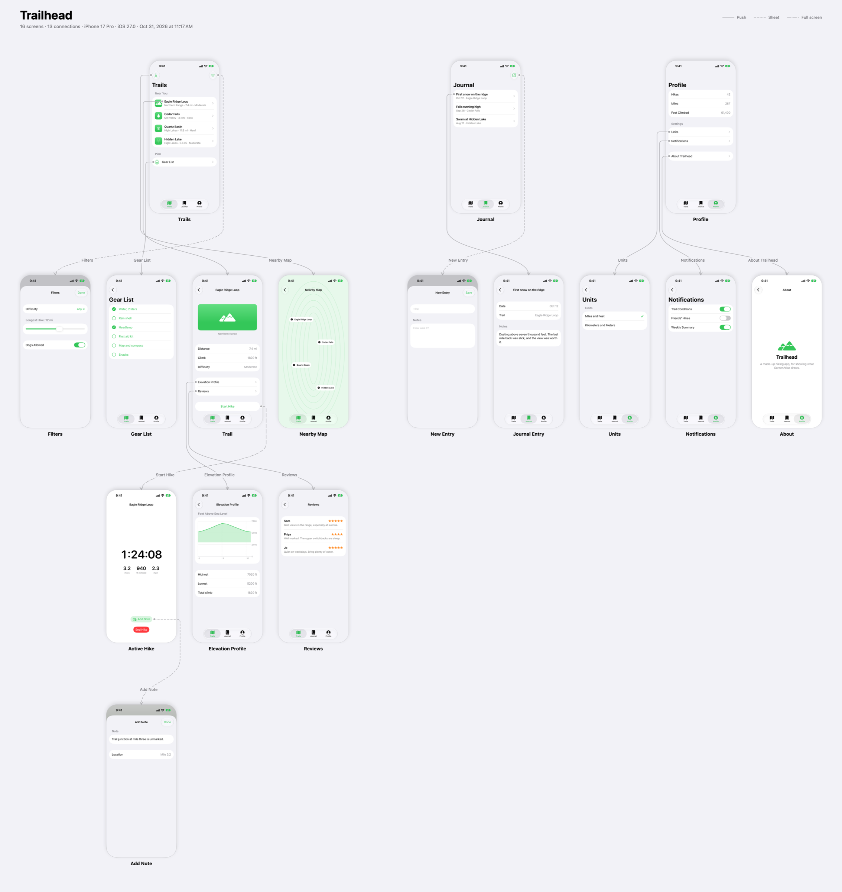
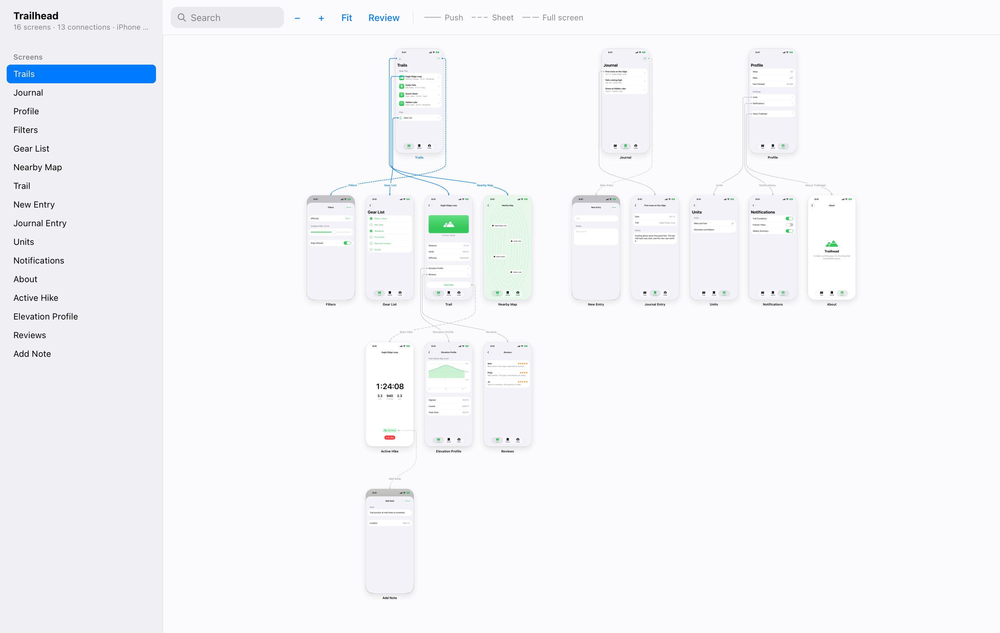

# ScreenAtlas

Maps a SwiftUI app's screens from its source, walks to each one in a simulator, and
draws the result, with each arrow starting on the actual button or row that opens the
next screen.



It draws two things:

- **`chart.png` / `chart.pdf`**: every screen at once, for a document or a message.
- **`map.html`**: the same picture to pan and zoom, laid out like a Mac app: a sidebar
  listing every screen, the map, and an inspector for the one selected. It is one file with
  the screenshots inside it, and it uses no network. `j` and `k` step through the screens,
  `/` searches, `f` fits the map to the window.

An app needs no changes to be mapped: no test target, no accessibility identifiers, no
launch hook. All that is specific to an app is one small JSON file. It needs no account
or network either, so a private app's screens stay on your machine.

**Status: experimental.** It has been run end to end on two real apps and the demo, and it
reads source without a compiler, so unfamiliar navigation code will show up as gaps. Issues
and fixes are welcome, with best-effort support.

## Try it

The repo includes [Trailhead](examples/Trailhead), a small made-up hiking app. This builds
it, photographs its 16 screens and draws the map, in `examples/Trailhead/out/`:

```bash
git clone https://github.com/rio-sanjuan/screen-atlas.git
cd screen-atlas
brew install xcodegen
swift run screenatlas run examples/Trailhead/atlas.json
open examples/Trailhead/out/map.html
```

[`docs/trailhead-map.html`](docs/trailhead-map.html) is that map, already built. Download
it and open it in a browser.



## Use

```bash
swift run screenatlas run path/to/atlas.json
```

| Command | What it does |
|---|---|
| `scan` | Reads the source and prints the screens, connections, routes and gaps. Touches no simulator. |
| `capture` | Scans, builds the app, and takes a screenshot of each screen. |
| `render` | Scans and redraws the chart and map from the last capture. |
| `run` | All of the above. |

`capture` and `run` also take `--no-build`, `--keep-booted` and `--only A,B`, which
recaptures those screens and keeps the rest from the last run.

Output goes in `out/` beside the config.

## Adding a project

Make a folder for it, anywhere you like, with an `atlas.json` (there's a template in
[`examples/`](examples/atlas.json), and a working one in
[`examples/Trailhead/`](examples/Trailhead/atlas.json)). Paths in it are relative to the
file, and output goes beside it. If the app is private, keep this folder outside the repo: `map.html` and
`chart.*` contain its screenshots. Git here ignores `projects/` and `out/` as a backstop.

```json
{
  "name": "My App",
  "project": "../MyApp",
  "workspace": "MyApp.xcworkspace",
  "scheme": "MyApp",
  "sources": ["App"],
  "roots": ["HomeTab"]
}
```

Run `scan` and read what it prints. Each screen shows the route it worked out, or says
why it has none. Then fill in only what it could not work out:

| Field | Meaning |
|---|---|
| `roots` | Views the map starts from. For a whole app, list each tab's root rather than the view holding the `TabView`: the route to a screen then begins by opening its tab. |
| `stopAt` | Screens drawn but not followed, which keeps a map of one tab from swallowing the app. |
| `exclude` | Views that aren't screens at all. |
| `excludePaths` | Parts of a path to skip when scanning, such as `App/Preview/`. |
| `screens` | Per screen, by view name: `title`, `steps`, `expect`, `skip` and `launchArguments`. |
| `edges` | Connections the scan can't see: `{"from": "A", "to": "B", "label": "Go", "kind": "sheet"}`. |
| `device`, `appearance` | Default to `iPhone 17 Pro` and `light`. |
| `launchArguments`, `launchEnvironment` | Passed to the app on every launch. |
| `timeout`, `settle` | Seconds a step may wait for its element (20), and a screen may settle before its screenshot (1). |

### Steps

A screen's `steps` replace the route the scan worked out, and screens beyond it build on
them. Each step is one of:

```json
{"tab": "Home"}             {"tap": "Settings"}         {"tapContaining": "Recent"}
{"longPress": "Header"}     {"longPressContaining": "Row"}
{"swipe": "up"}             {"back": true}              {"type": "hello"}
{"wait": 1.5}               {"waitFor": "Loaded"}
```

`tap` looks for the frontmost element whose accessibility label or identifier matches,
scrolling down for it if it isn't there yet. System prompts, such as a permission request,
are answered with Allow.

`expect` lists labels that must be on screen for a capture to count. Use it, and look at
the first run's screenshots: a tap that lands on a different element with the same label
opens the wrong screen, and without `expect` that still counts as a success.

When a step fails, `capture` prints what was on screen at the time, and the map shows the
screenshot of where it stopped, so a route can be fixed from the report.

## What it does and doesn't know

The scan reads syntax. It has no compiler behind it, so it follows what's written:

- **Followed:** `NavigationLink` in all its forms, `navigationDestination` route tables,
  `path.append`, `sheet`, `fullScreenCover`, `popover`, your own helpers wrapping those,
  `Tab` and `tabItem`. A link inside a component is credited to each screen composing it.
- **Labels:** taken from literal text, an `accessibilityLabel`, or the button that sets a
  presentation's state, including through the methods that button calls.
- **Not followed:** a value it can't type from the source, such as
  `NavigationLink(value: row.destination)`. These are listed as gaps rather than guessed.
  A closure parameter counts only if its name is exactly a route type's name.

So the arrows mean "the source declares this", not "someone tapped this". A route that
was tapped through is confirmed by its screenshot, but an arrow to a screen is not proof
that that particular link works.

An arrow starts on the element that opens its target, marked with a dot, when the capture
found that element on the screenshot: by the link's label, or by the last tap of a route
in the config. Selecting a screen on the map lights its elements up. An arrow starts from
the bottom of the card instead when there is nothing on the screenshot to point at: the
element is further down a scrolling screen, sits in an alert, or has no findable label.

A full run reinstalls the app, so each one starts as a new user. A screen that needs data
a new user lacks needs steps that create it, or a screen's `launchArguments`, if the app has
a debug hook that seeds it. Those carry over to the screens routed through that screen.

## How it runs

- One simulator per config, named `ScreenAtlas · <name>`, on the newest iOS installed. It
  is found by exact name and never borrowed, because its app gets wiped and its status bar
  rewritten. It shuts down afterwards unless `--keep-booted` is passed.
- The app builds in `~/Library/Caches/ScreenAtlas/<name>/`, not the shared DerivedData, so
  a build here can't collide with Xcode or another session building the same project.
- `Driver/` is one UI test that drives whichever app its plan names, by bundle identifier,
  launching it afresh for each screen. Its project is generated by `xcodegen`.

## Requirements

macOS with Xcode, an iOS simulator runtime, and [`xcodegen`](https://github.com/yonaskolb/XcodeGen).
iOS only so far: both targets of the driver are iOS, and the scan would need nothing new
for macOS, but the capture would.

## Tests

```bash
swift test
```

These also run when a release is published, and can be started by hand from the Actions
tab. The demo app's source is one of the fixtures, so a change that would redraw its map
shows up as a failing test.

## License

[MIT](LICENSE)
